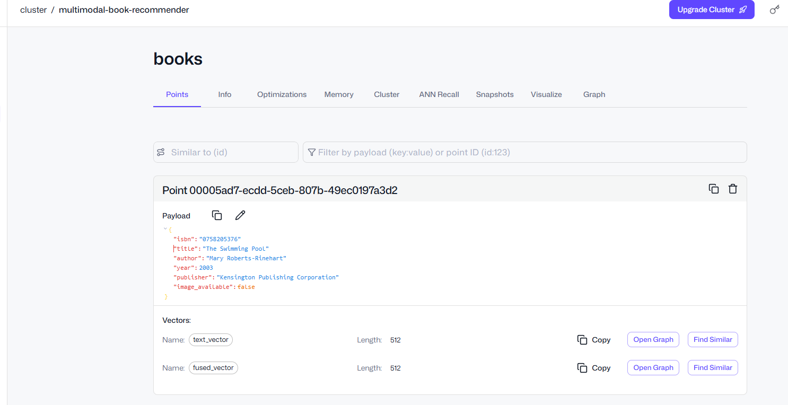
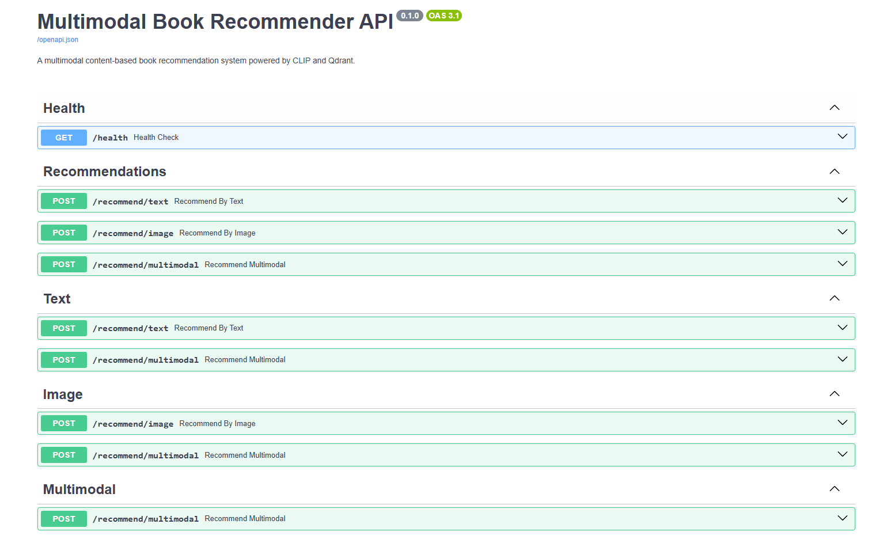
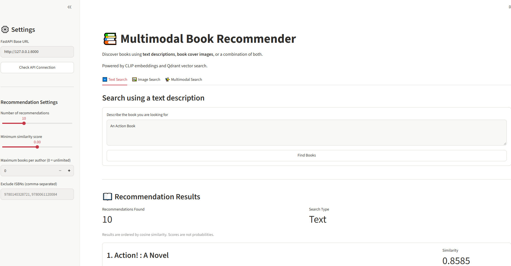

# 📚 Multimodal Book Recommender

A **multimodal content-based book recommendation system** that helps users discover books using text descriptions, book cover images, or a combination of both.

The system uses **CLIP (Contrastive Language–Image Pre-training)** to generate text and image embeddings, **Qdrant Cloud** for vector storage and similarity search, and a ranking layer to return relevant book recommendations.

Users can interact with the recommendation engine through a **FastAPI REST API** or a **Streamlit web application**.

---

## 🚀 Project Overview

Traditional book recommendation systems often rely on user ratings, purchase history, or collaborative filtering techniques.

This project explores a different approach: **multimodal content-based retrieval**.

Instead of depending only on user-item interactions, the system represents books using semantic information extracted from their metadata and cover images.

Users can search in three different ways:

1. **Text-Based Search:** Enter a natural-language description of the book they are looking for.
2. **Image-Based Search:** Upload a book cover image to find visually or semantically similar books.
3. **Multimodal Search:** Combine a text description and a reference image to improve retrieval relevance.

The system retrieves candidate books using vector similarity search and then applies a ranking layer to produce the final recommendations.

## ✨ Key Features

- **Multimodal Retrieval:** Supports text, image, and combined text-image queries.
- **CLIP Embeddings:** Uses a shared 512-dimensional embedding space for text and images.
- **Vector Search:** Stores and retrieves embeddings using Qdrant Cloud.
- **Embedding Fusion:** Combines text and image embeddings using configurable weights.
- **Recommendation Ranking:** Supports top-K ranking, minimum similarity thresholds, ISBN exclusions, and author-based diversity.
- **REST API:** Provides recommendation endpoints through FastAPI.
- **Interactive UI:** Provides a user-friendly interface using Streamlit.
- **Modular Design:** Separates data processing, model inference, vector storage, retrieval, ranking, and application layers.

---

## 📸 Project Screenshots

The following screenshots demonstrate the main components of the system, including the vector database, REST API, and interactive frontend.

### 1. Qdrant Vector Database

The project uses Qdrant Cloud to store and retrieve book embeddings.

The `books` collection contains book metadata and named vectors, including:

- `text_vector`: Text embeddings.
- `fused_vector`: Combined text and image embeddings.



### 2. FastAPI Backend

The backend exposes REST API endpoints for text-based, image-based, and multimodal book recommendations.

Interactive API documentation is available through Swagger UI.



### 3. Streamlit Frontend

The Streamlit application provides an interactive interface where users can:

- Search for books using natural-language descriptions.
- Upload book cover images.
- Combine text descriptions and images for multimodal search.
- Configure recommendation settings.
- View ranked recommendation results and similarity scores.



---

## 🛠️ Tech Stack

| Category                         | Technologies                     |
| -------------------------------- | -------------------------------- |
| Programming Language             | Python                           |
| Package & Environment Management | uv                               |
| Data Processing                  | Pandas, NumPy                    |
| Deep Learning                    | PyTorch                          |
| Multimodal Model                 | Hugging Face Transformers, CLIP  |
| Image Processing                 | Pillow (PIL)                     |
| Vector Database                  | Qdrant Cloud                     |
| Backend / REST API               | FastAPI, Pydantic                |
| Frontend                         | Streamlit                        |
| API Server                       | Uvicorn                          |
| Configuration                    | python-dotenv, pydantic-settings |
| Testing & Code Quality           | Pytest, Ruff                     |
| Version Control                  | Git, GitHub                      |

### Main Model

- **Model:** `openai/clip-vit-base-patch32`
- **Embedding Dimension:** 512
- **Inference:** Local model inference using PyTorch
- **Text and Image Embeddings:** Projected into a shared semantic vector space.

### Vector Database

- **Database:** Qdrant Cloud
- **Collection:** `books`
- **Distance Metric:** Cosine Similarity
- **Named Vectors:**
  - `text_vector`
  - `image_vector`
  - `fused_vector`

---

## 🏗️ Project Architecture

The project follows a **modular, layered architecture**. Each layer has a clearly defined responsibility, making the system easier to maintain, test, and extend.

### High-Level Architecture

```text
                    User
                     |
                     v
             Streamlit Frontend
                     |
                     v
               FastAPI Backend
                     |
             API Routes / Controllers
                     |
                     v
             Recommendation Layer
                  (Ranker)
                     |
                     v
              Retrieval Layer
                (Retriever)
                     |
              +------+------+
              |             |
              v             v
          CLIP Encoder   Qdrant Cloud
              |             |
              v             v
         Text / Image    Vector Search
          Embeddings     & Metadata
```

### Data & Indexing Pipeline

```text
Book-Crossing Dataset
          |
          v
    Data Loading
          |
          v
   Data Preprocessing
          |
          v
   Book Cover Images
          |
          v
     CLIP Encoder
          |
          v
   Embedding Generation
          |
          v
    Embedding Fusion
          |
          v
     Qdrant Indexing
          |
          v
      Qdrant Cloud
```

### Retrieval & Recommendation Workflow

**Text Search**

```text
Text Query
    |
    v
CLIP Text Encoder
    |
    v
text_vector Search
    |
    v
Candidate Books
    |
    v
Ranking
    |
    v
Recommendations
```

**Image Search**

```text
Uploaded Image
    |
    v
Image Preprocessing
    |
    v
CLIP Image Encoder
    |
    v
image_vector Search
    |
    v
Candidate Books
    |
    v
Ranking
    |
    v
Recommendations
```

**Multimodal Search**

```text
Text Query              Reference Image
    |                         |
    v                         v
CLIP Text Encoder       CLIP Image Encoder
    |                         |
    v                         v
Text Embedding          Image Embedding
    |                         |
    +------------+------------+
                 |
                 v
          Embedding Fusion
                 |
                 v
           fused_vector
                 |
                 v
            Qdrant Search
                 |
                 v
             Ranking
                 |
                 v
          Recommendations
```

---

## 🧩 Architecture Pattern: MVC

The application uses a layered architecture with responsibilities that can be mapped to the **Model-View-Controller (MVC)** pattern.

| MVC Component | Project Implementation                                          | Responsibility                                                                           |
| ------------- | --------------------------------------------------------------- | ---------------------------------------------------------------------------------------- |
| Model         | Data, CLIP Encoder, Embeddings, Qdrant Store, Retriever, Ranker | Data management, embedding generation, retrieval, and recommendation logic               |
| View          | `frontend/app.py`                                             | Displays the user interface and recommendation results                                   |
| Controller    | `api/routes.py`                                               | Receives requests, validates inputs, invokes application services, and returns responses |

**Important:** This is an MVC-style separation of concerns, not a strict implementation of the traditional MVC pattern. The backend also follows a layered design to separate business logic from infrastructure and API concerns.

---

## 📂 Project Structure

```text
multimodal-book-recommender/
│
├── data/
│   ├── raw/
│   │   ├── Books.csv
│   │   ├── Users.csv
│   │   └── Ratings.csv
│   │
│   └── processed/
│
├── artifacts/
│   └── covers/
│
├── src/
│   └── book_recommender/
│       ├── __init__.py
│       │
│       ├── config.py
│       │
│       ├── data/
│       │   ├── loader.py
│       │   ├── preprocessing.py
│       │   └── download_covers.py
│       │
│       ├── models/
│       │   └── clip_encoder.py
│       │
│       ├── embeddings/
│       │   ├── generator.py
│       │   └── fusion.py
│       │
│       ├── vector_store/
│       │   ├── qdrant_store.py
│       │   └── indexing.py
│       │
│       ├── retrieval/
│       │   └── retriever.py
│       │
│       ├── recommendation/
│       │   └── ranker.py
│       │
│       └── api/
│           ├── main.py
│           ├── schemas.py
│           └── routes.py
│
├── frontend/
│   └── app.py
│
├── tests/
│
├── .env.example
├── .gitignore
├── pyproject.toml
└── README.md
```

---

## ⚙️ Installation & Setup

### 1. Clone the Repository

```bash
git clone https://github.com/Ahmed-7-ML/Multimodal-Book-Recommender.git

cd Multimodal-Book-Recommender
```

### 2. Install uv

If you do not have `uv` installed, follow the official installation instructions:

https://docs.astral.sh/uv/getting-started/installation/

### 3. Install Project Dependencies

```bash
uv sync
```

### 4. Configure Environment Variables

Create a `.env` file in the project root using `.env.example` as a template.

```powershell
Copy-Item .env.example .env
```

Configure your Qdrant connection and other settings according to `src/book_recommender/config.py`.

**Note:** Keep credentials and API keys inside `.env`. Never commit `.env` to GitHub.

### 5. Prepare the Dataset

The project uses the [Book-Crossing dataset](https://www.kaggle.com/datasets/arashnic/book-recommendation-dataset).

Place the original CSV files inside:

```text
data/raw/
├── Books.csv
├── Users.csv
└── Ratings.csv
```

The raw and processed datasets are excluded from Git because of their file sizes.

### 6. Prepare Book Cover Images and Vector Index

The data pipeline includes modules for:

- Loading and preprocessing the dataset.
- Downloading book cover images.
- Generating CLIP embeddings.
- Fusing text and image embeddings.
- Indexing books and vectors in Qdrant.

Run the corresponding pipeline scripts/modules according to their entry points and configuration.

---

## ▶️ Running the Application

The backend and frontend run in separate terminals.

### 1. Start the FastAPI Backend

```powershell
uv run uvicorn book_recommender.api.main:app --reload
```

Backend URL:

```text
http://127.0.0.1:8000
```

Interactive API documentation:

```text
http://127.0.0.1:8000/docs
```

### 2. Start the Streamlit Frontend

Open another terminal:

```powershell
uv run streamlit run frontend/app.py
```

Streamlit will provide a local URL, usually:

```text
http://localhost:8501
```

---

## 🔌 API Endpoints

The FastAPI backend exposes the following endpoints:

| Method | Endpoint                  | Description                                       |
| ------ | ------------------------- | ------------------------------------------------- |
| GET    | `/health`               | Checks whether the API is running                 |
| POST   | `/recommend/text`       | Retrieves recommendations using a text query      |
| POST   | `/recommend/image`      | Retrieves recommendations using an uploaded image |
| POST   | `/recommend/multimodal` | Retrieves recommendations using text and an image |

### 1. Health Check

```http
GET /health
```

### 2. Text-Based Recommendation

```http
POST /recommend/text
Content-Type: application/json
```

Example request:

```json
{
    "query": "A science fiction novel about space exploration",
    "top_k": 10,
    "min_score": 0.2
}
```

### 3. Image-Based Recommendation

```http
POST /recommend/image
Content-Type: multipart/form-data
```

Parameters:

- `file`: Image file (JPEG, PNG, or WebP).
- `top_k`: Number of recommendations.
- `min_score`: Minimum similarity score.
- `exclude_isbns`: Optional ISBNs to exclude.
- `max_per_author`: Optional maximum recommendations per author.

### 4. Multimodal Recommendation

```http
POST /recommend/multimodal
Content-Type: multipart/form-data
```

Parameters:

- `text`: Text description.
- `file`: Reference image.
- `top_k`: Number of recommendations.
- `min_score`: Minimum similarity score.
- `text_weight`: Text embedding weight.
- `image_weight`: Image embedding weight.

The text and image weights must sum to `1.0`.

Example:

```text
text_weight = 0.7
image_weight = 0.3
```

### Recommendation Output

The API returns a structured response containing:

- `query_type`
- `total`
- `recommendations`

Each recommendation includes:

- `rank`
- `id`
- `isbn`
- `title`
- `author`
- `year`
- `publisher`
- `image_available`
- `score`

**Note:** The returned score represents cosine similarity, not a probability or user rating.

---

## 🧪 Testing

Run the test suite using:

```powershell
uv run pytest
```

To run a specific retrieval test:

```powershell
uv run python tests/test_retrieval.py
```

Tests that require real CLIP inference and real data may be marked as `slow`.

---

## 📝 Commands & Notes

### Useful Commands

| Command                                                            | Description                            |
| ------------------------------------------------------------------ | -------------------------------------- |
| `uv sync`                                                        | Install and synchronize dependencies   |
| `uv add package-name`                                            | Add a project dependency               |
| `uv add --dev package-name`                                      | Add a development dependency           |
| `uv run --active pytest`                                         | Run tests using the active environment |
| `uv run --active ruff check .`                                   | Run Ruff lint checks                   |
| `uv run --active uvicorn book_recommender.api.main:app --reload` | Start FastAPI                          |
| `uv run --active streamlit run frontend/app.py`                  | Start Streamlit                        |
| `git status`                                                     | Check Git working tree status          |

### Important Notes

1. **Environment Variables:** Store Qdrant credentials and configuration in `.env`, not in source code.
2. **Dataset Files:** Raw and processed datasets are excluded from version control because of their size.
3. **Generated Artifacts:** Downloaded cover images and other generated artifacts are excluded from Git.
4. **CLIP Inference:** The CLIP model is loaded locally, so the first run may require downloading model files.
5. **Vector Dimensions:** The configured Qdrant vector dimensions must match the selected CLIP model output dimension (512 for the current checkpoint).
6. **Image Retrieval:** Image-based retrieval requires book cover image embeddings to be generated and indexed in Qdrant.
7. **Re-indexing:** Downloading new cover images does not automatically update existing Qdrant points. Re-run the indexing pipeline when the indexed data changes.
8. **Similarity Scores:** Cosine similarity scores are ranking signals, not calibrated probabilities.
9. **Qdrant Availability:** The API requires a valid Qdrant connection and an initialized collection.

---

## 🔮 Future Improvements

- Add book cover previews directly to recommendation results.
- Improve candidate retrieval and ranking strategies.
- Introduce user-based collaborative filtering.
- Combine content-based and collaborative filtering in a hybrid recommender.
- Add recommendation evaluation metrics such as Precision@K, Recall@K, and NDCG@K.
- Improve image and metadata coverage.
- Deploy the backend and frontend to cloud infrastructure.
- Add caching and performance monitoring.

---

## 👨‍💻 Developer

**Ahmed Akram**

AI Engineering & Machine Learning

GitHub: [Ahmed-7-ML](https://github.com/Ahmed-7-ML)

Email: ahmedakram3ai@gmail.com

Linkedin: [linkedin.com/in/ahmed-akram-kamel-amer](https://linkedin.com/in/ahmed-akram-kamel-amer)

---

## 📄 License

This project is intended for educational and portfolio purposes.
